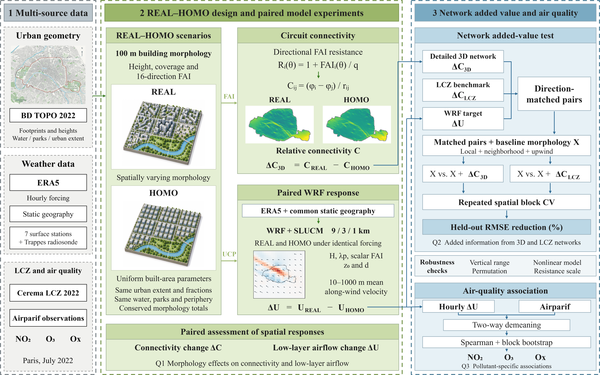

# How the spatial arrangement of buildings shapes low-layer airflow: Evidence from a Paris heatwave

[Editable framework](images/framework.pptx) · [Study-area map](images/study_area.png) · [Figure reproduction guide](docs/FIGURES.md)

Code accompanying the Paris July 2022 REAL–HOMO study. The repository links directional morphological connectivity from Circuitscape with paired WRF airflow responses, and tests whether network information improves spatial prediction beyond local, neighborhood and upwind morphology.



## Methodology overview

1. **Shared REAL–HOMO contrast.** Building-resolved BD TOPO data are aggregated to 100 m. HOMO homogenizes the built portion within Paris while retaining urban fractions, non-built surfaces and peripheral morphology. Aggregate footprint, volume proxy and directional frontal-area totals are conserved at the morphology construction scale.
2. **Directional connectivity.** Sixteen inflow directions define resistance as `R = 1 + FAI/q`. REAL and HOMO share network settings; `ΔC = C_REAL − C_HOMO`. The reference scale is fixed, not independently normalized by direction or scenario.
3. **Paired atmospheric response.** WRF uses 9/3/1 km one-way nesting under common meteorological forcing. The experiment covers 16–20 July 2022; the first 24 h are spin-up. The response is a 10–1000 m layer-mean velocity difference projected onto the common background transport direction, not a pollutant or mass flux.
4. **Network added value.** A 12-variable local/neighborhood/upwind baseline is compared with the same baseline plus direction-matched connectivity. Five spatial blocks and ten repeated partitions are used in each of four retained directions. Fine-scale morphology, nonlinear-model, vertical-range, permutation and resistance-scale checks are separate controls.
5. **LCZ and environmental associations.** LCZ is a locally calibrated category-compression benchmark, not an LCZ–WRF run. Airparif analyses compare simulated hourly airflow responses with observed NO₂, O₃ and molar Ox after station/hour demeaning; they do not estimate counterfactual pollutant concentrations.

## Project structure

```text
├── README.md
├── requirements-analysis.txt       # Small statistical reproduction environment
├── requirements.txt                # Full geospatial / plotting dependencies
├── codes/
│   ├── reproduce_primary.py         # Reproduce the main 40 spatial comparisons
│   ├── run.py                       # Relocatable launcher for archived scripts
│   ├── release_paths.py             # Local data / WRF path configuration
│   ├── new_study/                   # Scientific scripts, original stage names
│   └── manuscript_figures/scripts/  # Shared and final figure code
├── notebooks/
│   └── Paris_manuscript_figures.ipynb
├── datas/
│   ├── analysis_inputs/             # Frozen small model-input arrays
│   ├── results/                     # Original statistical result tables
│   └── README.md                    # Data sources and access routes
├── configs/                        # WRF/WPS configuration templates
├── docs/                           # Entry points, data layout and limitations
└── images/                         # Workflow and selected manuscript figures
```

## Quick start

Use Python 3.11 in a new environment. The numerical comparison code was originally run with NumPy 1.26.4 and scikit-learn 1.4.2.

```bash
python -m venv .venv
# Linux/macOS: source .venv/bin/activate
# Windows PowerShell: .venv\Scripts\Activate.ps1
python -m pip install -r requirements-analysis.txt
python codes/reproduce_primary.py
```

This uses the distributed frozen model inputs, without downloading ERA5 or running WRF/Circuitscape. Expected primary result: **40/40 comparisons improve; median RMSE reduction 3.46%**. New results go to `outputs/primary_reproduction/`. These 40 comparisons are repeated spatial partitions within one event, not independent meteorological experiments.

For the full morphology, WRF post-processing and figure workflow:

```bash
python -m pip install -r requirements.txt
python codes/run.py new_study/07_real_homo_design/scripts/build_real_homo_design_pilot.py
```

The second command requires the external morphology inputs; it is not a data-free demo. Read [the workflow guide](docs/WORKFLOW.md) and [data layout](docs/DATA_LAYOUT.md) before running archived scripts. Figure code is consolidated in [the notebook](notebooks/Paris_manuscript_figures.ipynb); rendering all maps requires the original processed spatial inputs and WRF-derived arrays.

## Data sources

| Source | Use | Access |
|---|---|---|
| IGN BD TOPO, June 2022 | Building footprints/heights, water, vegetation and Paris boundary | [IGN](https://geoservices.ign.fr/bdtopo) |
| ERA5, 16–20 July 2022 | WRF initial and lateral forcing | [Copernicus CDS](https://cds.climate.copernicus.eu/) |
| WPS geographic data | Terrain, land use, soil and vegetation | [NCAR](https://www2.mmm.ucar.edu/wrf/users/download/get_sources_wps_geog.html) |
| Cerema Paris LCZ, 2022 | Category-compression benchmark | [Cerema / data.gouv.fr](https://www.data.gouv.fr/fr/datasets/cartographie-des-zones-climatiques-locales-lcz-des-93-territoires-de-plus-de-50-000-habitants-en-france/) |
| NOAA ISD / IGRA | Seven surface stations and Trappes profiles | [ISD](https://www.ncei.noaa.gov/products/land-based-station/integrated-surface-database), [IGRA](https://www.ncei.noaa.gov/products/weather-balloon/integrated-global-radiosonde-archive) |
| Airparif hourly observations | NO₂, O₃ and derived Ox | [Airparif Open Data](https://data-airparif-asso.opendata.arcgis.com/) |

Original third-party datasets, ERA5 GRIB files, WPS/WRF binaries and large model output are not redistributed here. No API keys or login credentials are included. Small derived model arrays and result tables are provided to inspect and reproduce the core comparison.

## Interpretation and reproducibility

- Circuit current describes relative morphology connectivity; it is not wind speed or ventilation probability.
- The primary RidgeCV protocol and nested spatial tuning controls are distinct. Their results must not be substituted for one another.
- Four retained directions have 5, 12, 12 and 29 matched hours. Direction-wise comparisons have unequal meteorological support.
- O₃ association is station-sensitive: removing PA01H reverses the association in the available-hour sensitivity subset. The station-exclusion table is included.
- Archived scripts retain their original scientific equations, masks, folds and scenario definitions. Release changes relocate paths and remove authoring-environment-only plotting dependencies. Historical pilot scripts are not all final paper entry points.
- The release was checked for syntax, packaged input consistency and sensitive files. Packaging is not a new end-to-end WRF or geospatial rerun.

See [provenance and release checks](docs/RELEASE.md) for the source manifest and verification scope. The manuscript is in preparation; no article DOI or journal acceptance is claimed.
